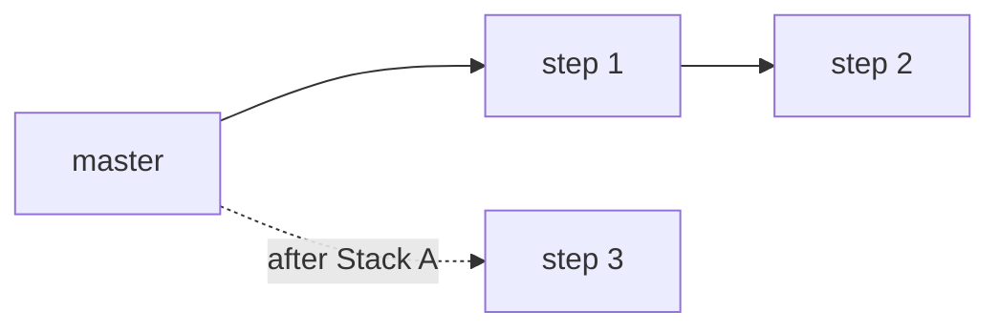

# Master plan template

Note: `vault/Plans/<Project>/<Project> master.md`

The headings are a menu, not a form: drop a section that would be empty, add one if the project needs it (data migration, provider constraints). Keep **Coverage**, **Stacks**, **Open questions** and **Changelog**: they are what make the plan useful.

````markdown
---
type: plan
status: draft
milestone: "[[<Milestone>]]"
tech-prep: "[[<Project> tech prep]]"
date: YYYY-MM-DD
tags:
  - plan
---

# <Project> — implementation plan

Part of [[<Milestone>]] · Tech prep: [[<Project> tech prep]]

> [!info] Sources
> - [[<Project> tech prep]] (validated YYYY-MM-DD) · or Claude session plan `~/.claude/plans/<slug>.md`, snapshot in [[<Project> source plan]]
> - Lanterne chapters, Decision notes, branches in flight, vendor docs. One line each, each one a link.

<One short paragraph: what ships at the end, the slicing choice (how many stacks, which order) and why.>

## Tech prep recap
A condensed but faithful summary of the tech prep, heading by heading, keeping its headings so each line can be traced back. Decisions with their rationale, mechanisms reused, validations and limits, design risks. No new design here.

Every decision, contract, validation and limit line starts with an ID, numbered across the whole recap. Step notes cite these IDs instead of copying the decision. IDs are never renumbered: a dropped decision keeps its ID and says `dropped (<date>, <reason>)`. A project-wide decision links its Decision note.
- **D1** <decision> — <rationale>
- **D2** [[<Decision note>]] — <decision in a few words>

## Review against the code
What checking the tech prep against current `origin/master` and the vault showed. Each item is **VERIFIED** (with `path:line`, commit or command) or **HYPOTHESIS**.
- Stale references: a file or type renamed, moved or deleted since the tech prep.
- Already done: parts merged or sitting on a branch.
- Gaps: things the tech prep needs but doesn't mention (a migration, an `.env.example` line, embedded data, a Glossary term, a fake provider). The file list of `internal/campaign/` is a good checklist for a feature package.
- Contradictions: tech prep vs milestone, tech prep vs a Decision or Lanterne note edited since, tech prep vs code.
- Prerequisites: previous milestones or branches that must merge first.
Write "Nothing found" rather than dropping the section.

## Implementation strategy
- How the work is sliced and why this order: riskiest first, vertical slices.
- How master stays working between stacks: "engine action not exposed as an LLM tool until Stack N", route unused, screen not linked.
- Data concerns: migrations, embedded data.
- Any change from the tech prep's PR stack, with the reason.

## Stacks

### Stack A — <one-sentence slice> · base `master` · <independent | needs Stack X merged>
| Step | Branch | Concern |
|---|---|---|
| [[<Project> step 1\|1]] | `feat/backend/<slug>` | <one sentence> |
| [[<Project> step 2\|2]] | `feat/backend/<slug>` | <one sentence> |
| [[<Project> step 3\|3]] | `feat/frontend/<slug>` | <one sentence> |

**Master after this stack merges:** <what the table screen shows or doesn't, what is wired up.>

### Stack B — …

Optional mermaid diagram when several stacks depend on each other. Labels equal to note names plus `class … internal-link;` make the nodes clickable:


## Coverage
Every requirement, decision, validation, limit of the tech prep and every Task of the milestone, mapped to where it gets done. Go through the tech prep heading by heading.

| Tech prep item (heading) | Decision | Step | Notes |
|---|---|---|---|
| <item> ([[<Project> tech prep#<heading>]]) | D3 | [[<Project> step 2\|2]] | |
| <item> | D8 | Out of scope | → [[Post-MVP]] |
| <item> | — | Dropped | <reason, from the review> |

## End-to-end verification
The manual scenario to run once the last stack is merged, usually the milestone's Exit: commands, the simulator run, the table-screen walkthrough.

## 🔭 Out of scope
Carried over from the tech prep, plus anything this plan defers. One line each, with where it lands (a later milestone, [[Post-MVP]]).

## ❓ Open questions
Numbered. Say which step each one blocks. Once settled: `~~question~~ **Settled YYYY-MM-DD**: decision`.

## Changelog
How the plan moved during implementation, appended by `/obsidian-step-done` (newest last). Empty when the plan is first written.
- <YYYY-MM-DD> · step <N> done · <D-ids changed, a few words each> · steps <list> updated
````

`\|` inside a wikilink in a table cell is how Obsidian escapes the alias pipe; outside tables, write `[[<Project> step 1|1]]`.
