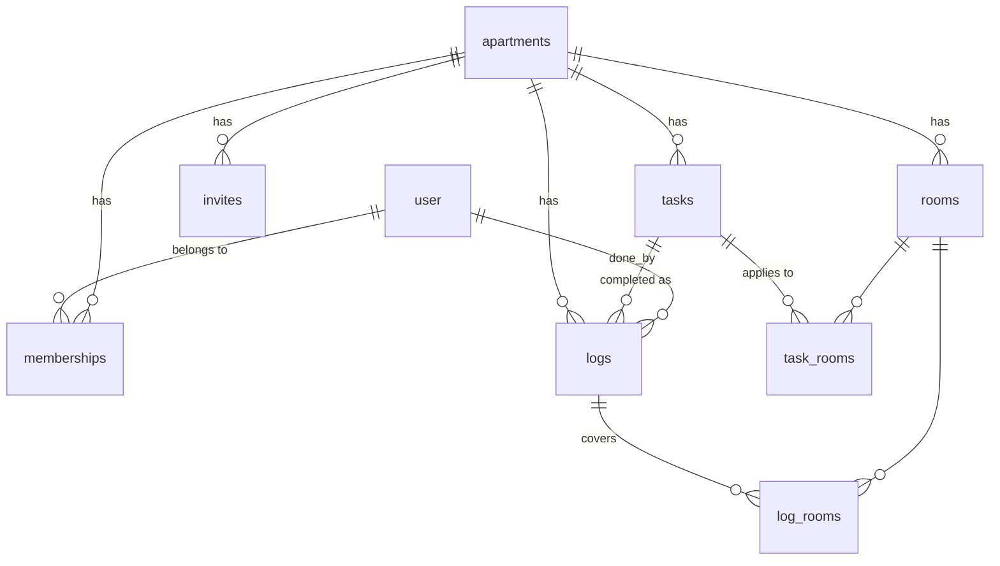

---
tags:
  - project
  - data
---

# Data model

Nine tables. Everything hangs off `apartments`, and every query is scoped by "is the current user a member of this apartment".



Rooms and tasks meet through `task_rooms`; a log points at one task, a person, and zero or more rooms through `log_rooms`.

| Table | Holds | Notes |
| --- | --- | --- |
| `user` | You and your girlfriend | Better Auth's own table (text `id`, `name`, `email`); `name` is the display name. Its `session`, `account`, `verification` tables come with it |
| `apartments` | A flat, a holiday rental | `archived_at` when you move out, `timezone` ([[Apartment timezone]]) |
| `memberships` | Who belongs to which apartment | Many-to-many; `role` owner / member |
| `invites` | Single-use join codes | Expires after 7 days; records who used it |
| `rooms` | Rooms of one apartment | `position` for ordering, `archived_at`; name unique among active rooms |
| `tasks` | Chores of one apartment | Frequency + `all_rooms` flag ([[All-rooms flag]]), `position` for the Home order ([[Manual task order]]), `archived_at`; name unique among active tasks |
| `task_rooms` | Which rooms a task applies to | Ignored when `all_rooms` is true |
| `logs` | One completion of a task | `done_by` (always the person who logged it, see [[Log only for yourself]]), `done_at`, optional note |
| `log_rooms` | Which rooms a log covered | Zero rows = whole apartment, only for "anywhere" tasks ([[Rooms when logging]], [[Room-specific logs need a room]]) |

## Postgres schema

Stack-agnostic; translate to Drizzle (see [[Stack]]).

```sql
-- Users: Better Auth's "user" table (id text, name, email, ...), generated by
-- its CLI into the same Drizzle schema. Every user FK below is text.

create table apartments (
  id          uuid primary key default gen_random_uuid(),
  name        text not null,
  timezone    text not null default 'Europe/Brussels',
  archived_at timestamptz,
  created_at  timestamptz not null default now()
);

create table memberships (
  apartment_id uuid not null references apartments(id) on delete cascade,
  user_id      text not null references "user"(id) on delete cascade,
  role         text not null default 'member' check (role in ('owner','member')),
  joined_at    timestamptz not null default now(),
  primary key (apartment_id, user_id)
);

create table invites (
  code         text primary key,              -- nanoid(12), URL-safe
  apartment_id uuid not null references apartments(id) on delete cascade,
  created_by   text not null references "user"(id),
  expires_at   timestamptz not null,
  used_at      timestamptz,
  used_by      text references "user"(id)
);

create table rooms (
  id           uuid primary key default gen_random_uuid(),
  apartment_id uuid not null references apartments(id) on delete cascade,
  name         text not null,
  position     int  not null default 0,
  archived_at  timestamptz
);
create unique index rooms_active_name_idx
  on rooms (apartment_id, lower(name)) where archived_at is null;

create table tasks (
  id                 uuid primary key default gen_random_uuid(),
  apartment_id       uuid not null references apartments(id) on delete cascade,
  name               text not null,
  description        text,
  all_rooms          boolean not null default false,
  position           int     not null default 0,
  frequency_interval int,      -- e.g. 1, 2, 3
  frequency_unit     text,     -- 'day' | 'week' | 'month'; both null = "as needed"
  archived_at        timestamptz,
  created_at         timestamptz not null default now(),
  check ((frequency_interval is null) = (frequency_unit is null)),
  check (frequency_interval is null or frequency_interval between 1 and 365),
  check (frequency_unit is null or frequency_unit in ('day','week','month'))
);
create unique index tasks_active_name_idx
  on tasks (apartment_id, lower(name)) where archived_at is null;

create table task_rooms (
  task_id uuid not null references tasks(id) on delete cascade,
  room_id uuid not null references rooms(id) on delete cascade,
  primary key (task_id, room_id)
);

create table logs (
  id           uuid primary key default gen_random_uuid(),
  apartment_id uuid not null references apartments(id) on delete cascade,  -- denormalised for fast feeds
  task_id      uuid not null references tasks(id),
  done_by      text not null references "user"(id),
  done_at      timestamptz not null default now(),
  note         text check (length(note) <= 500),
  created_at   timestamptz not null default now()
);
create index logs_feed_idx on logs (apartment_id, done_at desc, id desc);

create table log_rooms (
  log_id  uuid not null references logs(id) on delete cascade,
  room_id uuid not null references rooms(id),
  primary key (log_id, room_id)
);
```

## Rules the server must enforce

The database can't enforce these:

- A task's rooms, a log's task and a log's rooms all belong to the same apartment
- A log's rooms are among the task's eligible rooms (all active rooms if `all_rooms`, else `task_rooms`)
- A log of a room-specific task (`all_rooms` false) names at least one room ([[Room-specific logs need a room]])
- `done_by` is the session user, never taken from the request
- Archived tasks and rooms can't receive new logs, but still show in the feed ([[Archive, never delete]])

## Feed query

A single join:

```sql
-- $2, $3 = done_at and id of the last row on the previous page (null for page 1)
select l.id, l.done_at, u.name as who, t.name as task,
       coalesce(array_agg(r.name order by r.position) filter (where r.id is not null), '{}') as rooms
from logs l
join "user" u on u.id = l.done_by
join tasks t on t.id = l.task_id
left join log_rooms lr on lr.log_id = l.id
left join rooms r on r.id = lr.room_id
where l.apartment_id = $1
  and ($2::timestamptz is null or (l.done_at, l.id) < ($2, $3))
group by l.id, u.name, t.name
order by l.done_at desc, l.id desc
limit 50;
```

## Related

- [[API]] · [[Implementation details]]
